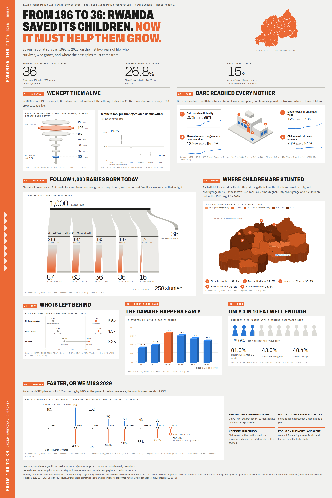

# From 196 to 36: Rwanda saved its children. Now it must help them grow.

**Team Winners · Moses Mugisha** · 2026 NISR Infographic Competition
Topic: Rwanda Demographic and Health Survey 2025 (RDHS7): child survival and stunting.

▶ **Watch the video:** https://www.youtube.com/watch?v=k2gFTIm6qgA

## The story

1. **Survival:** under-5 deaths fell from 196 per 1,000 births (2000) to 36 (2025), and pregnancy-related deaths fell by 84%.
2. **Care:** births in health facilities rose from 25% to 98%, and 4+ antenatal visits from 12% to 78%.
3. **The cohort:** follow 1,000 babies. 964 survive, but about 258 are stunted, and the poorest fifth carries the most.
4. **Where and who:** district stunting ranges from 8.7% in Nyarugenge to 38.8% in Gicumbi. A mother's education makes a 6.5× gap and wealth a 4.3× gap.
5. **The first 1,000 days:** stunting doubles between 6 months and 2 years, and only 27% of children aged 6–23 months get a minimum acceptable diet.
6. **Timeline:** the national target (NST2) is 15% stunting by 2029. At today's pace Rwanda reaches about 23% (our estimate).

## Where to find things

| What | Where |
|---|---|
| Final submission (poster PDF and video MP4) | `submission/` |
| Interactive infographic | `output/web/index.html` (open in a browser; add `?poster` to the address for the 2000×3000 poster) |
| Poster image | `output/poster/rwanda_rdhs2025_poster.png` |
| Clean dataset (895 rows) | `data/rdhs2025_clean.csv` (column meanings in `data/DATA_DICTIONARY.md`) |
| Calculated insights | `data/insights.csv`, `data/selected_insights.csv` |
| Story and chart design | `data/STORYBOARD.md`, `data/CHART_SPECS.md` |
| Checks against the report | `data/verification_report.md`, `data/hand_check.csv` |
| Raw tables extracted from the PDFs | `data/raw/` |
| Data pipeline (Python) | `analysis/` |
| District boundaries | `assets/geo/rwa_adm2.geojson` (geoBoundaries, CC BY 4.0) |
| Video plan and source | `brag-output/` (`brag-plan.md`, `work/video2.html`, `work/render.mjs`, `work/audio2.py`) |

## How the data was made

Each step is a script in `analysis/`, run with `python3`:

1. `locate.py` finds the tables in the report.
2. `extract.py` pulls them out.
3. `checks.py` verifies the numbers against the report.
4. `clean.py` builds the clean dataset.
5. `calculate.py` computes the insights.
6. `select.py` picks the insights for the story.
7. `specs.py` writes the chart specifications.
8. `build_web.py` builds the web page.

The maths used:

- percentage change;
- average annual rate of reduction;
- least-squares trend;
- z-tests with 95% confidence intervals from Appendix B;
- a compound-rate projection to 2029.

## Source

NISR, *Rwanda Demographic and Health Survey 2025*, Final Report (with table and page references on every chart). Target: NST2 2024–2029. The source PDFs are not stored in this repo; download links are in `NISR_Downloads/DHS_2025/SOURCES.tsv`.
